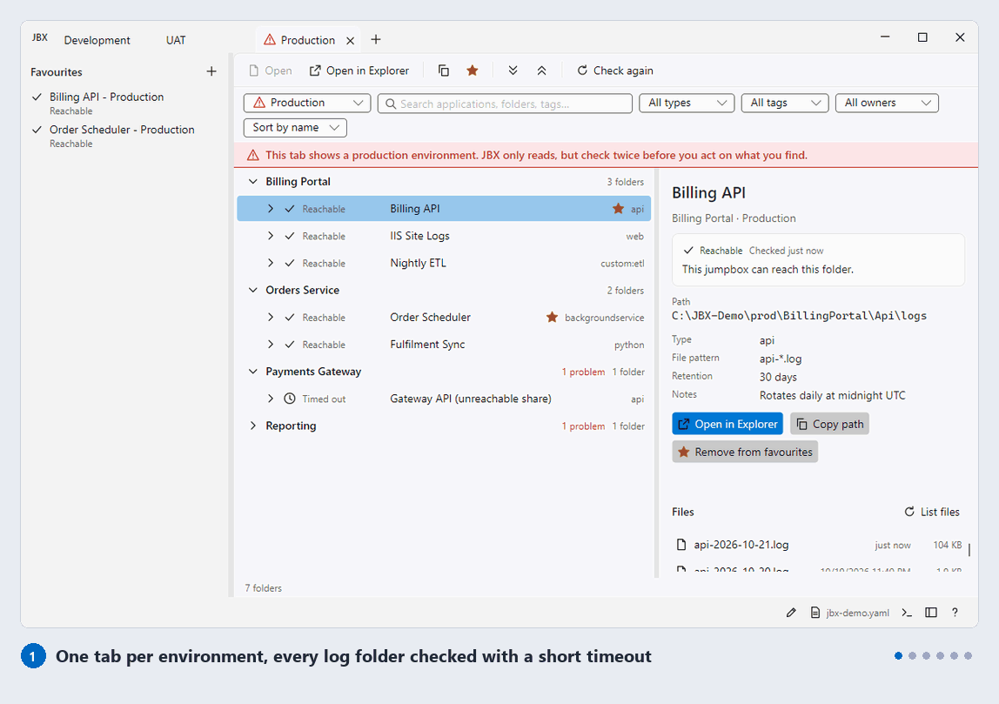
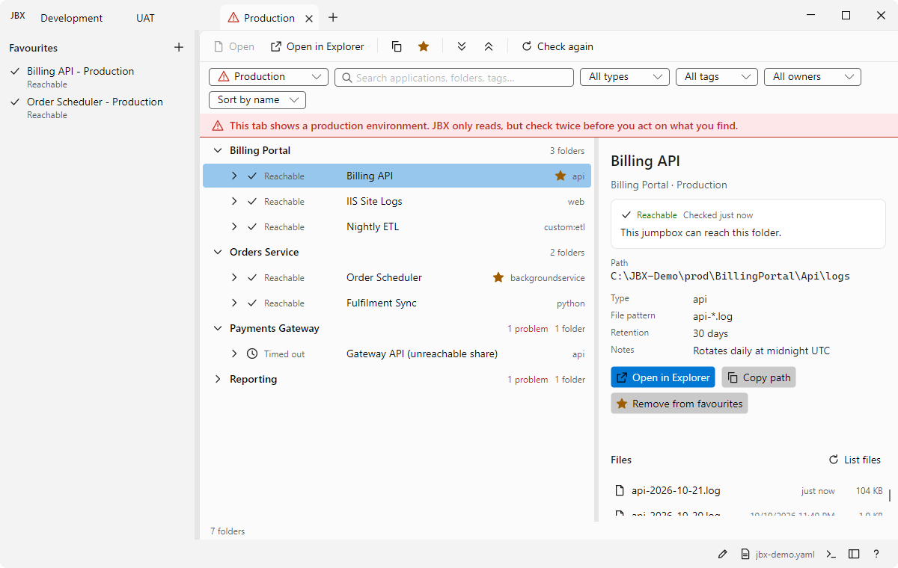
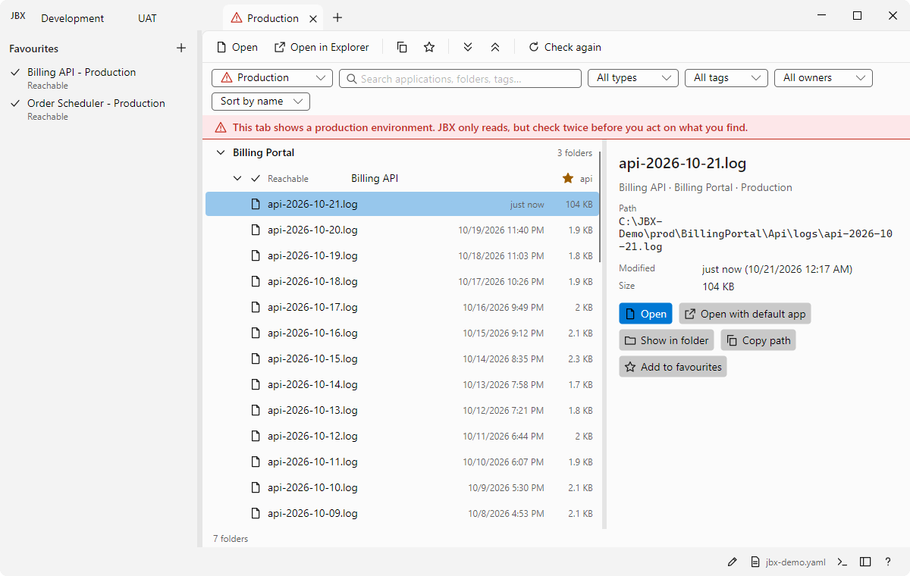
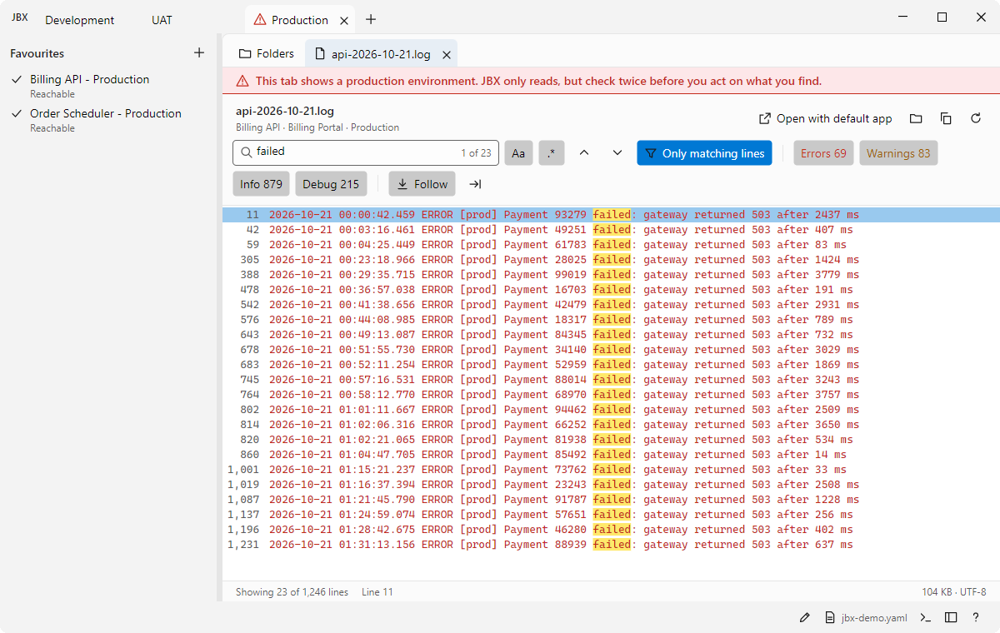
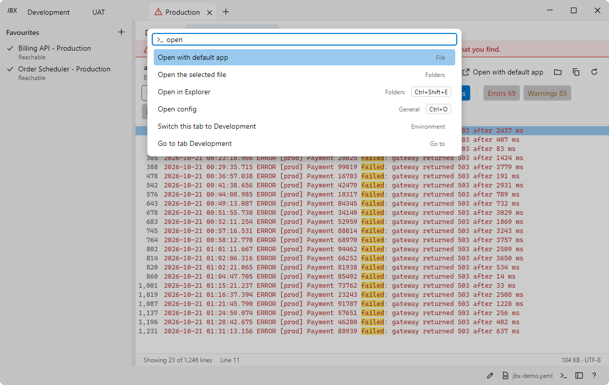

<div align="center">

# JBX - Jump Box Explorer

**Every application's log folders, in every environment, from one config file.**<br>
A small, read-only Windows app for the jump box you connect to when something breaks.

[](https://github.com/getaxtools/JBX/actions/workflows/ci.yml)
[](https://github.com/getaxtools/JBX/actions/workflows/codeql.yml)
[](https://scorecard.dev/viewer/?uri=github.com/getaxtools/JBX)
[](#license)




</div>

> **Status: early development.** There is no signed release yet. The first release (v0.1.0) will cover config-driven browsing, one tab per environment, favourites, reachability checks, the log viewer and opening folders and files.

## Why JBX

During an incident, finding the right log usually means a wiki page, a spreadsheet of share paths and a lot of trial and error in File Explorer, where one unreachable share can freeze the window for a minute. Then you open the file in Notepad, and do it all again for the next server.

JBX replaces that with one config file, owned by the platform team and shared with everyone:

| | |
|---|---|
| **One tab per environment** | Development, UAT and Production side by side. Production is clearly marked so it is never mistaken for UAT. |
| **Never freezes** | Every folder is checked in the background with a short timeout. One dead share shows *Timed out*; the rest of the window carries on. |
| **Clear answers** | *Reachable*, *Access denied*, *Not found* and *Timed out* are different states, each with what to do next. |
| **Built-in log viewer** | Open a log in a tab inside its environment. Search with highlights, show only matching lines, filter by level, follow a file as it grows and jump to a line. Large files are indexed as they are read, never loaded whole into memory. |
| **Favourites** | Pin the folders and files you open every day, with their reachability shown. |
| **Command palette** | Every command, folder and tab is one search away with <kbd>Ctrl</kbd>+<kbd>Shift</kbd>+<kbd>P</kbd>. |
| **Zero install** | One `JBX.exe`. No installer, no admin rights, no runtime to set up first. |

## Screenshots

<table>
  <tr>
    <td width="50%"></td>
    <td width="50%"></td>
  </tr>
  <tr>
    <td align="center"><sub>Every folder checked with a short timeout, so one dead share never blocks the rest</sub></td>
    <td align="center"><sub>Expand a folder to see its newest log files</sub></td>
  </tr>
  <tr>
    <td></td>
    <td></td>
  </tr>
  <tr>
    <td align="center"><sub>Search a log and show only the matching lines</sub></td>
    <td align="center"><sub>The command palette</sub></td>
  </tr>
</table>

## Getting started

### Try it with the demo

```powershell
git clone https://github.com/getaxtools/JBX.git
cd JBX
pwsh scripts/New-JbxDemo.ps1            # made-up log folders under %USERPROFILE%\JBX-Demo
dotnet run --project src/Jbx.Desktop     # then Ctrl+O and pick samples\jbx-sample.yaml
```

### Describe your own estate

One YAML (or JSON) file lists environments, applications and folder templates. JBX resolves every template for every environment:

```yaml
version: 1

globals:
  logShare: "\\\\fs01.contoso.test\\AppLogs"

environments:
  - id: uat
    displayName: UAT
  - id: prod
    displayName: Production

applications:
  - id: billing-portal
    displayName: Billing Portal
    owner: Finance Platform Team
    tags: [finance, tier1]
    folders:
      - type: api
        label: Billing API
        pathTemplate: "{{logShare}}\\{{env}}\\BillingPortal\\Api\\logs"
        logFilePattern: "api-*.log"
        notes: Rotates daily at midnight UTC
```

Templates can use `{{env}}`, `{{app}}`, `{{date:yyyy-MM-dd}}`, any global (`{{logShare}}`) and environment variables (`{{envvar:NAME}}`). If the file has a mistake, JBX lists every problem at once, with its line, and keeps the last good config open. Edit the config with <kbd>Ctrl</kbd>+<kbd>Shift</kbd>+<kbd>O</kbd>, and JBX reloads it when you save.

See [samples/jbx-sample.yaml](samples/jbx-sample.yaml) for a fuller example.

## Keyboard shortcuts

| Shortcut | Action | Shortcut | Action |
|---|---|---|---|
| <kbd>Ctrl</kbd>+<kbd>Shift</kbd>+<kbd>P</kbd> | Command palette | <kbd>Ctrl</kbd>+<kbd>F</kbd> | Search |
| <kbd>Ctrl</kbd>+<kbd>T</kbd> / <kbd>Ctrl</kbd>+<kbd>W</kbd> | New / close tab | <kbd>F3</kbd> / <kbd>Shift</kbd>+<kbd>F3</kbd> | Next / previous match |
| <kbd>Ctrl</kbd>+<kbd>Tab</kbd> | Next tab | <kbd>Ctrl</kbd>+<kbd>G</kbd> | Go to line |
| <kbd>Ctrl</kbd>+<kbd>Shift</kbd>+<kbd>PgUp</kbd> / <kbd>PgDn</kbd> | Move tab | <kbd>Ctrl</kbd>+<kbd>L</kbd> | Follow the file as it grows |
| <kbd>Ctrl</kbd>+<kbd>Shift</kbd>+<kbd>E</kbd> | Open in Explorer | <kbd>Ctrl</kbd>+<kbd>D</kbd> | Add or remove a favourite |
| <kbd>Ctrl</kbd>+<kbd>Shift</kbd>+<kbd>C</kbd> | Copy path | <kbd>Ctrl</kbd>+<kbd>B</kbd> | Show or hide favourites |
| <kbd>F5</kbd> | Check folders again | <kbd>Ctrl</kbd>+<kbd>O</kbd> / <kbd>Ctrl</kbd>+<kbd>R</kbd> | Open / reload config |
| <kbd>F6</kbd> | Next pane | <kbd>F1</kbd> | About and all shortcuts |

## Principles

- **Read-only.** JBX never writes to the folders it shows you. It only opens them in Explorer or your default app.
- **No network code.** JBX makes no network connections of its own and collects no data. It reads the paths you configure, with your own access. Architecture tests fail the build if a networking type appears.
- **Never hangs.** Every file-system call has a timeout and a concurrency cap and runs off the UI thread.
- **Keyboard first and accessible.** Everything works from the keyboard, with screen-reader names and light, dark and high-contrast themes.

## Releases and verification

Releases are built by GitHub Actions from a tag, and each one includes:

| File | What it is |
|---|---|
| `JBX.exe` | the self-contained app (Windows 10 22H2 or later, x64) |
| `SHA256SUMS.txt` | checksums for every file in the release |
| `JBX-<version>.cdx.json` | software bill of materials (CycloneDX) |
| `THIRD-PARTY-NOTICES.txt` | licences of the packages inside JBX |

Check a download before you copy it onto a jump box:

```powershell
Get-FileHash .\JBX.exe -Algorithm SHA256                  # compare with SHA256SUMS.txt
gh attestation verify .\JBX.exe --repo getaxtools/JBX     # proves it was built by this repository's workflow
```

Every push to `main` also produces an unsigned preview build, kept for 14 days under the workflow run's artifacts.

## Build from source

Requirements: Windows 10 22H2 or later and the [.NET 10 SDK](https://dotnet.microsoft.com/download).

```powershell
dotnet build
dotnet test
dotnet run --project src/Jbx.Desktop
dotnet publish src/Jbx.Desktop -p:PublishProfile=win-x64 -o artifacts/publish   # single JBX.exe
```

The screenshots and tour above are generated from the demo by `scripts/New-ReadmeMedia.ps1`.

## Contributing

Contributions are welcome. Please read [CONTRIBUTING.md](CONTRIBUTING.md) and [CODING-STANDARDS.md](CODING-STANDARDS.md) first, and follow the [Code of Conduct](CODE_OF_CONDUCT.md). For help, see [SUPPORT.md](SUPPORT.md). Report security issues privately as described in [SECURITY.md](SECURITY.md).

## License

Licensed under either of [MIT](LICENSE-MIT) or [Apache-2.0](LICENSE-APACHE) at your option. Contributions are accepted under the same terms, with a [Developer Certificate of Origin](https://developercertificate.org) sign-off on every commit. Third-party licences are listed in [THIRD-PARTY-NOTICES.txt](THIRD-PARTY-NOTICES.txt) and in the app's About box.
